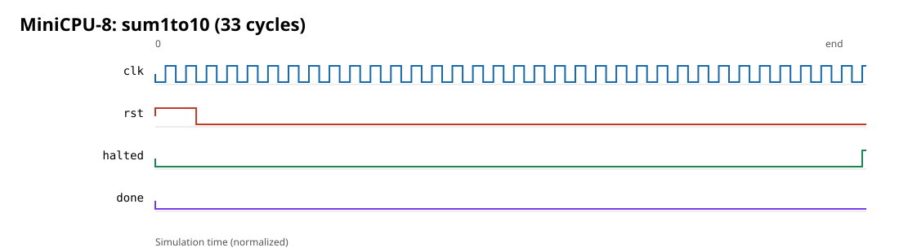
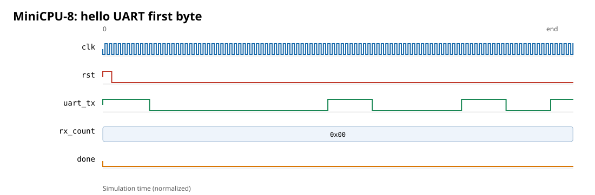

# MiniCPU-8

An educational 8-bit **single-cycle CPU** written in VHDL-2008. It includes
memory-mapped UART and GPIO, two-simulator verification, differential fuzzing,
mutation checks, FPGA constraints and a hardware bring-up plan. The RTL and
programs are simulation-verified; Phase 4 has not been run on a physical FPGA.

The ISA itself is unchanged from Phase 2. `docs/ISA.md` is the normative
specification and is mechanically cross-checked against the hardware,
assembler and golden model.

## Features

- 8-bit datapath; 8-bit PC (256 instructions, modulo-256 wrap)
- 8 registers `R0..R7`; **R0 hardwired to zero**
- 16-bit fixed-width instructions; all 16 opcodes used
- 256 x 16-bit instruction ROM from a VHDL generic
- 256 x 8-bit data RAM storage, of which **240 bytes (`0x00..0xEF`) are CPU
  RAM**; `0xF0..0xFF` is memory-mapped I/O
- Z/N/C/V flags; ARM-style carry for SUB (`C=1` means no borrow)
- ALU: ADD, SUB, AND, OR, NOT, XOR, SHL, SHR, PASS_B
- ADDI; LOAD/STORE; CMP; MOV/NOP/SUBI pseudo-instructions
- BEQ/BNE register-compare branches; flag branches
  BZ/BNZ/BCS-BHS/BCC-BLO/BN/BNN/BLT/BGE
- JMP, CALL/RET with a single-level R7 link
- **MMIO:** 8N1 UART TX + busy status, 8-bit GPIO output, synchronized GPIO
  input, free-running cycle counter
- HALT freezes the PC; unused ROM is HALT-filled
- No pipelining, interrupts or stack pointer (by design)

## Architecture

```
        ┌─────────────────────────────── fpga_top / cpu_top ───────────────────────────────┐
        │                                                                                  │
 PC ───►│ ROM ──► instr ──► control_unit ──► reg_write / mem_read / mem_write / flag_write │
        │          │        │                    / alu_src_imm / rd2_from_rd / wb_sel      │
        │          │        │                    / pc_sel / cond_code / link / halt         │
        │          │        └──► fields rd/rs/rt ──► register_file ──► rd1 ───────────────┐│
        │          │                                  ▲      └──────► rd2 ──► mux ──► rd2 ─┐││
        │          └──► imm6 ─► sext ────────────────┘                 ALU B ▲             │││
        │                                                                     │             │││
        │   ALU (ADD/SUB/logic/shift/PASS_B) ─► result, Z N C V ─► flag_reg   │             │││
        │        │                                                           │             │││
        │        ├─► address = rs + imm (mod 256) ─► address decoder         │             │││
        │        │        ├─ 0x00..0xEF ─► data_ram (async read, sync write) │             │││
        │        │        └─ 0xF0..0xFF ─► mmio                              │             │││
        │        │             ├─ UART_TX (0xF0) / UART_STATUS (0xF1)         │             │││
        │        │             ├─ GPIO_OUT (0xF2) / GPIO_IN (0xF3)            │             │││
        │        │             └─ CYCLE_COUNT_LO (0xF4)                        │             │││
        │        └─► writeback mux ◄── ALU / RAM-or-MMIO / PC+1 ──────────────┘             │││
        │                              │                                                   │││
        │                              └─► register_file waddr (R7 when link)              │││
        │                                                                                  │││
        │   eq(rs,rt) ─┐                                                                   │││
        │   branch_cond(flags, cond) ─┴─► PC logic: +1 / absolute / PC+1+imm / R7 / hold ───┘││
        └──────────────────────────────────────────────────────────────────────────────────┘
```

Everything except the PC, register file, flags, data RAM, peripherals and
board reset synchronizer is combinational; those update on the same rising
edge, so one instruction retires per cycle. A LOAD or STORE to `0xF0..0xFF`
is routed to MMIO instead of data RAM, with the same one-cycle timing.

## I/O map

| Address | Name | Access | Behavior |
|---|---|---|---|
| `0xF0` | `UART_TX` | W | Start an 8N1 byte; ignored while `UART_STATUS.tx_busy=1`; reads 0 |
| `0xF1` | `UART_STATUS` | R | Bit 0 = `tx_busy`, bits 7:1 = 0 |
| `0xF2` | `GPIO_OUT` | W/R | 8-bit LED register, reset 0 |
| `0xF3` | `GPIO_IN` | R | Two-flop-synchronized switches, reset 0 |
| `0xF4` | `CYCLE_COUNT_LO` | R | Low byte of a free-running cycle counter, wraps |
| `0xF5..0xFF` | reserved | R | Read 0; writes ignored |

Writes to read-only addresses are ignored. Full details, decisions and
consequences are in `docs/ISA.md` §8. `.data` may only initialize
`0x00..0xEF`; the assembler rejects data that would enter the I/O region.

The assembler predefines `UART_TX`, `UART_STATUS`, `GPIO_OUT`, `GPIO_IN` and
`CYCLE_COUNT_LO`. Because the ISA immediate/offset is signed 6-bit, the
symbols are encoded as their signed equivalents (`0xF0` is `-16`), so
`loadi r1, UART_STATUS` and `load r2, [r0+UART_STATUS]` work directly.

## Demo programs

| Program | Output / behavior | Cycles |
|---|---|---:|
| `hello.asm` | `Hello, MiniCPU-8!` + newline over UART | 1,915 |
| `fibonacci.asm` | `0 1 1 2 3 5 8 13 21 34 55 89 144 233 ` + newline | 4,008 |
| `primes.asm` | all 54 primes below 256, decimal, + newline (188 bytes) | 276,236 |
| `gpio_demo.asm` | GPIO_IN `0xA5` -> GPIO_OUT `0x5A` (readback checked) | 6 |

`fibonacci` and `primes` use a shared decimal-print routine; it saves and
restores the single-level R7 link in RAM because it itself calls `putc`.
UART bytes are captured by an independent receiver in the testbenches and
compared byte-for-byte, including the newline.

## Build and test

### NVC (primary)

Requires [NVC](https://www.nickg.me.uk/nvc/) (tested with 1.23) and Python 3.

```sh
make test       # Python tests + consistency + all NVC testbenches + quick fuzz
make fuzz       # full 200-program ALU/RAM differential fuzz
make iofuzz     # 40-program UART/GPIO/cycle-counter differential fuzz
make waves      # GHDL VCDs in docs/waves/
make clean
```

`make test` must end with `ALL TESTBENCHES PASSED`; any failure aborts make.
The VHDL flow is dependency-aware: one stamp per analysed unit, with explicit
prerequisites, so only changed units and their dependents are re-analysed.

### GHDL (second simulator)

Requires GHDL with VHDL-2008 support (tested with GHDL 6.0.0; CI pins the
upstream 6.0.0 LLVM release):

```sh
make test-ghdl
```

Every testbench is analysed and run, and each must print its `ALL TESTS
PASSED` banner. CI keeps separate `nvc` and `ghdl` jobs.

### Synthesis and place-and-route (GHDL + Yosys + nextpnr)

The flow targets the **Lattice iCE40-HX8K Breakout Board**
(iCE40HX8K-CT256, 12 MHz). It needs:

- GHDL 6.0.0 (or a compatible version)
- [ghdl-yosys-plugin](https://github.com/ghdl/ghdl-yosys-plugin) built for the
  same GHDL and Yosys (the GHDL 6.0.0 tag was used here)
- Yosys 0.70+ and nextpnr-ice40 0.11.1 + icestorm (for the bitstream)

```sh
# Standard plugin install: Yosys can load it with -m ghdl.
make PROGRAM=hello synth        # -> build/synth/fpga_top.json + yosys.log
make PROGRAM=hello pnr FREQ=12  # -> build/synth/fpga_top.{asc,bin} + nextpnr.log

# Local plugin outside the Yosys plugin directory:
make PROGRAM=hello synth \
  GHDL_PLUGIN=/path/to/ghdl-yosys-plugin/ghdl.so \
  GHDL_PREFIX=/path/to/ghdl/lib/ghdl
```

`PROGRAM` selects any package generated from `programs/*.asm`. The generated
`build/synth/fpga_program.vhd` references the chosen ROM/RAM package, so the
bitstream contains that program at build time (no runtime loader).

### Post-synthesis verification

Requires Icarus Verilog and Yosys `cells_sim.v` (installed by Yosys):

```sh
make post-synth
```

This synthesizes `post_synth_top` with the same GHDL/Yosys flow, exports the
gate-level Verilog netlist, simulates it with Icarus Verilog, and compares PC,
flags, registers, all 256 RAM bytes, cycle count and captured UART bytes with
the Python golden model for `sum1to10`, `array_sum`, `call_ret` and `hello`.

## Synthesis results (real numbers)

Target: iCE40HX8K-CT256, 12 MHz board clock, nextpnr seed 1, `PROGRAM=hello`.

| Metric | Result |
|---|---:|
| LUT4 (`SB_LUT4`) | 2,186 |
| Flip-flops | 2,032 |
| `SB_CARRY` | 29 |
| Block RAM | 0 |
| Logic cells used by nextpnr | 4,197 / 7,680 (54%) |
| I/O pins | 19 / 206 |
| Requested clock | 12.00 MHz |
| **Fmax after routing** | **37.70 MHz** |
| Critical path | 26.52 ns (6.62 ns logic + 19.90 ns routing) |

The path is routing-dominated and crosses the flag/branch/PC, ROM, register
file, ALU, data-RAM mux and writeback mux. The asynchronous-read data RAM is
mapped to ~2,000 flip-flops on iCE40; block RAM has synchronous read and would
need a pipeline stage. A smaller iCE40UP5K (iCEBreaker) build reached 4,197 /
5,280 LCs (79%) and **failed placement**, so the HX8K was chosen.

Full tool versions, commands, the failed UP5K attempt, critical-path details
and honest limitations are in [`docs/SYNTHESIS.md`](docs/SYNTHESIS.md).

## Waveforms

`make waves` produces:

- `docs/waves/sum1to10.vcd` — one `cpu_top` running the sum program
- `docs/waves/hello_first_byte.vcd` — hello up to the first captured `'H'`

View them with GTKWave, Surfer, or any VCD viewer:

```sh
gtkwave docs/waves/sum1to10.vcd
```

The repository also includes compact SVG timing views rendered from the VCDs:





Recreate the source VCDs with `make waves`. The SVGs can be regenerated with
`tools/vcd_to_svg.py`; use GTKWave or Surfer for interactive waveform browsing.

## Phase 4 audit and hardware status

`docs/AUDIT.md` records the verification audit, coverage limits, 23/23
detected RTL mutations, and synthesis environment blocker. The full NVC and
GHDL suites pass, as do the 200-program ALU/RAM and 40-program I/O differential
fuzz runs. The fresh synthesis seed sweep could not run because
`ghdl-yosys-plugin` is not installed in the audit environment; the Phase 3
resource/timing figures above are historical measurements, not a fresh Phase
4 result. No bitstream has been programmed on a physical board.

See [`docs/BRINGUP.md`](docs/BRINGUP.md) for board selection, build/program
commands, safe wiring, expected demo output and the hardware measurement log.
The HX8K is the recommended first target; all PCF assignments remain marked
unverified until tested on the exact board revision.

## Files

| File | Role |
|---|---|
| `minicpu_pkg.vhd` | shared types, opcodes, conditions, I/O map constants |
| `alu.vhd` | 8-bit ALU (9 ops), Z/N/C/V |
| `branch_cond.vhd` | condition decoder |
| `register_file.vhd` | 8x8, two async reads, sync write, R0=0 |
| `flag_reg.vhd` | Z/N/C/V register |
| `pc.vhd` | reset / increment / load / hold |
| `instr_rom.vhd` | 256-word ROM, HALT-filled |
| `data_ram.vhd` | 256x8 RAM, async read, sync write, debug optional |
| `control_unit.vhd` | combinational decoder |
| `uart_tx.vhd` | 8N1 transmitter, `CLK_FREQ`/`BAUD` generics |
| `gpio.vhd` | GPIO_OUT register + 2-flop GPIO_IN synchronizer |
| `cycle_counter.vhd` | free-running 8-bit counter |
| `mmio.vhd` | I/O address decode and peripheral integration |
| `cpu_top.vhd` | single-cycle datapath + RAM/MMIO address decoder |
| `fpga_top.vhd` | synthesizable HX8K board top, reset synchronizer |
| `post_synth_top.vhd` | verification wrapper exposing debug ports for netlist sim |
| `*_tb.vhd` | self-checking testbenches (unit, system, demos) |
| `uart_rx_model.vhd` | independent testbench UART receiver (not synthesizable) |
| `programs/*.asm` | assembly programs incl. `.data` strings/arrays |
| `tools/assembler.py` | two-pass assembler, I/O symbols, errors |
| `tools/isa_sim.py` | Python golden model incl. MMIO/UART timing |
| `tools/check_consistency.py` | ISA + I/O map cross-checks |
| `tools/random_programs.py` | normal and I/O random program generators |
| `tools/fuzz.py` | differential fuzz, normal and `--io` modes |
| `tools/post_synth.py` | Yosys netlist + Icarus post-synthesis checks |
| `constraints/hx8k_breakout.pcf` | HX8K pin constraints (unverified on hardware) |
| `*_rom.vhd` | **generated** ROM + RAM packages |
| `docs/ISA.md` | normative ISA + I/O spec |
| `docs/SYNTHESIS.md` | real synthesis/timing report |
| `docs/ROADMAP.md` | what was done and next steps |

## Test summary

| Test / script | What it covers |
|---|---|
| `tools/test_assembler.py` | 119 tests: encodings, labels, `.data`, I/O symbols, error paths |
| `tools/test_isa_sim.py` | 86 tests: ALU/flags, RAM, branches, CALL/RET, MMIO, UART timing |
| `tools/check_consistency.py` | 152 checks: pkg ↔ assembler ↔ ISA.md ↔ golden model ↔ hardware |
| `alu_tb` | 459,300 checks: exhaustive ALU vs independent reference |
| `alu_compare_tb` | 393,216 checks: all `(a,b)` through SUB+branch_cond |
| `branch_cond_tb` | 256 checks: all flags × conditions |
| `control_unit_tb` | 2,048 checks: all opcodes/functions/conditions |
| `data_ram_tb` | 16 checks: init, write, gating, read-during-write |
| `instr_rom_tb` | 8 checks: INIT and HALT fill |
| `register_file_tb` | 20 checks: dual read, R0, gating |
| `flag_reg_tb` | 6 checks |
| `pc_tb` | 10 checks |
| `uart_tx_tb` | 31 checks: independent receiver, framing, timing, busy-write ignored |
| `gpio_tb` | 11 checks: output register, readback, 2-flop input delay |
| `cycle_counter_tb` | 10 checks: reset, increment, wrap |
| `mmio_tb` | 25 checks: decode, status, GPIO, counter, read-only writes |
| `io_cpu_tb` | 18 checks: CPU-level MMIO, UART polling, RAM isolation |
| `cpu_tb` | 70 checks over 8 programs: final state and cycle counts |
| `cpu_edge_tb` | 12 checks: PC wrap and HALT fill |
| `reset_gating_tb` | 7 checks: reset suppresses writes |
| `hello_tb` / `fibonacci_tb` / `primes_tb` | 22 / 42 / 192 checks: UART bytes + cycles |
| `gpio_demo_tb` | 8 checks: driven GPIO_IN → checked GPIO_OUT |
| `tools/fuzz.py` | 20 quick / 200 full normal programs, 0 mismatches |
| `tools/fuzz.py --io` | 8 quick / 40 full I/O programs, 0 mismatches |
| `tools/post_synth.py` | 4 programs on the Yosys/iCE40 netlist, 0 mismatches |

`cpu_tb` cycles: `sum1to10=33`, `shift_branch=8`, `array_sum=54`,
`find_max=32`, `call_ret=179`, `unsigned_vs_signed=10`, `pc_wrap=4`,
`r0_guard=7`.

## Conventions

- `ieee.numeric_std` only; no non-standard packages.
- No inferred latches: combinational processes assign defaults first.
- SUB = `A + not(B) + 1`; C=1 means no borrow.
- Logic ops clear C and V; shifts update C/V as documented.
- R0 always reads 0; writes ignored for every instruction.
- Reset suppresses register, flag and RAM writes; PC/flags and MMIO reset.
- All 256 ROM words are valid; unused words are HALT.
- UART writes while busy are ignored; software must poll `UART_STATUS`.
- GPIO_IN is synchronized and has two cycles of latency.

## What has and has not been verified

**Verified in this repository**

- All testbenches under NVC 1.23 and GHDL 6.0.0 (same check counts).
- Normal and I/O differential fuzzing against the Python golden model.
- Synthesis of the HX8K board top with GHDL/Yosys.
- nextpnr place-and-route and bitstream generation with real Fmax/resource
  reports.
- Post-synthesis simulation of the actual Yosys/iCE40 netlist for four
  programs, compared byte-for-byte with the golden model.
- Assembler/ISA/I/O consistency checks.

**Not verified**

- No physical board was available: the bitstream was **not programmed** and
  no LEDs/UART were observed on hardware.
- Pin assignments, LED polarity, reset debounce, UART voltage/baud and the
  exact header pinout are **unverified**.
- The 37.70 MHz Fmax is nextpnr's static estimate, not a hardware measurement
  or a multi-corner timing sign-off.
- ECP5 was not attempted; only the iCE40 HX8K target was built.
- No interrupts, stack pointer, pipelining or formal verification were added.

## Known limitations

- Single-cycle critical path includes ROM + register file + ALU + RAM/MMIO +
  control; no pipeline.
- Data RAM is 240 architectural bytes; `0xF0..0xFF` is MMIO.
- CALL/RET link is one level in R7; nested calls save R7 explicitly.
- LOADI/ADDI immediates are signed 6-bit (-32..+31), so high addresses need
  arithmetic or the predefined I/O symbols.
- UART uses an integer clock divider. At the board's 12 MHz and 115200 baud
  the divisor is 104, giving 115384.6 baud (+0.16% error); this is normally
  within UART tolerance but has not been measured on hardware.
- The iCE40 flow maps the async-read data RAM to flip-flops, so the UP5K does
  not place; HX8K is the supported target.
- `primes.asm` is intentionally simple trial division and takes 276,236
  cycles at 1 MHz simulation.
- HALT stops the CPU but the UART may still finish transmitting and the cycle
  counter keeps running.
- No physical hardware, timing sign-off, formal proof or ECP5 result.

## Roadmap

See [`docs/ROADMAP.md`](docs/ROADMAP.md). The recommended next architecture is
**MiniCPU-16** with a stack pointer and 16-bit addressing; a RISC-V subset is
the alternative. Hardware bring-up, timing constraints and a CI synthesis job
are the immediate engineering follow-ups.
